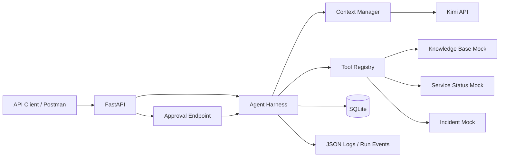
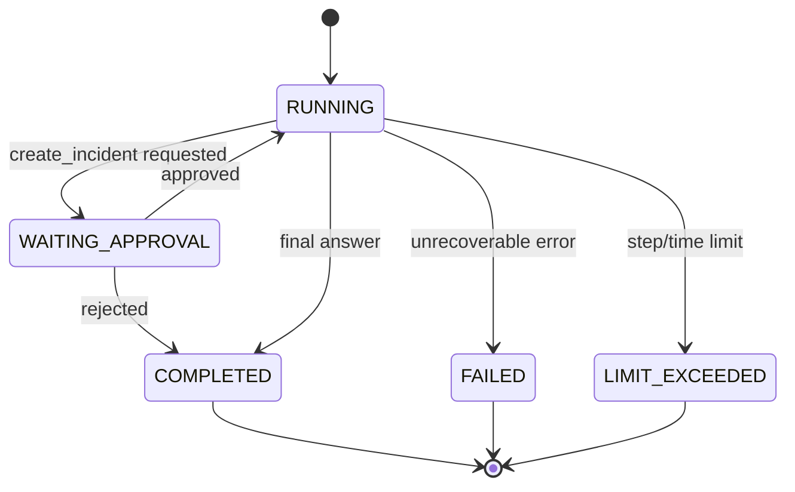

# Operations Assistant Agent Harness Plan

- Document status: Design baseline
- Last updated: 2026-11-21

> Extension note: multi-turn conversations (P7a) and the minimal terminal REPL (P7c) are implemented; see `docs/multi-turn-chat.en.md`. The original design baseline in this document remains frozen.

## 1. Objectives

Build a runnable operations assistant Agent Harness that receives user goals through an HTTP API, uses the Kimi model to drive a ReAct execution loop, and invokes knowledge base search, service status query, and incident creation tools as needed.

Core deliverables:

- LLM–tool execution loop and structured tool calling
- Tool input and output validation
- Persistable Agent state and complete execution history
- Timeouts, bounded retries, exponential backoff, and exception recovery
- Context window compaction
- Step count and active execution time limits
- User approval before `create_incident` invocation
- Structured logs, execution Traces, and automated tests
- Lightweight Mock Dataset and Postman Collection

## 2. Confirmed Design Decisions

1. **Model provider**: Use the Kimi API through an OpenAI-compatible interface.
2. **Agent pattern**: Adopt ReAct, with the model determining subsequent actions based on tool observations.
3. **Context window**: Retain 15 rounds of uncompressed history; beyond that, compact the earliest 10 rounds and retain the most recent 5 rounds.
4. **Request reliability**: Set timeout and max_retry for both LLM and tool calls, using exponential backoff with jitter for retries.
5. **Safety approval**: `create_incident` may execute only after explicit user approval.

## 3. Scope and Non-Goals

### 3.1 Scope of This Phase

- Single-user, locally running POC
- One independent Agent Run per user goal
- Synchronous execution until completion, failure, a limit is reached, or approval is pending
- SQLite persistence, allowing history queries and recovery of Runs awaiting approval after a service restart
- Three deterministic Mock tools
- Unit tests and API integration tests

### 3.2 Non-Goals

- Multi-tenancy, user management, and production-grade permission systems
- Distributed task queues, multi-Worker scheduling, and high availability
- Integration with real knowledge bases, monitoring platforms, or incident platforms
- Vector databases and complex semantic retrieval
- Parallel tool calls
- General-purpose workflow orchestration platform

## 4. Technology Stack

| Category | Choice | Rationale |
| --- | --- | --- |
| Language | Python 3.11+ | Well suited to the LLM, API, and testing ecosystems |
| Web API | FastAPI + Uvicorn | Rapidly provides strongly typed REST APIs |
| Data validation | Pydantic v2 | Unified validation for APIs, tool inputs and outputs, and LLM tool arguments |
| LLM SDK | OpenAI Python SDK | Calls the Kimi-compatible interface through a custom base URL |
| Agent core | Custom implementation | Clearly demonstrates the loop, state machine, retries, approvals, and limits without relying on LangChain |
| Database | SQLite + SQLAlchemy | No external service dependencies while supporting persistence and transactions |
| Logging | Python logging, JSON format | Provides structured, correlatable execution logs |
| Testing | pytest, FastAPI TestClient | Covers unit tests and API integration tests |
| API debugging | Postman Collection | Covers Run creation, queries, Traces, and approval workflows |

The model name is configured through an environment variable rather than hardcoded, so it can be adapted to the Kimi models available to the account.

### 4.1 Reasons for Not Using an Existing Agent Framework

This design does not use an off-the-shelf Agent execution framework such as LangChain AgentExecutor, nor does it replace the Harness core with a black-box Agent from a framework. The main reasons are as follows:

1. **Highlight the core capabilities assessed in this evaluation**: The Agent loop, state management, failure handling, and safety controls are the primary focus of the evaluation. Using a complete Agent executor directly would hide many critical implementations, making these capabilities harder to demonstrate and inspect.
2. **Precisely control execution semantics**: The 15/10 Compact behavior, unified step and time budgets, error classification, number of format corrections, and retry boundaries all require deterministic custom behavior to avoid inconsistencies between framework default policies and the Harness requirements.
3. **Approvals and side effects must be explicitly guaranteed by the project**: Argument binding for `create_incident`, pause/resume behavior, protection against duplicate approvals, and idempotent creation cannot be satisfied automatically by a generic ReAct Agent alone.
4. **Improve testability and auditability**: With custom state transitions and tool dispatch, each step can be verified precisely using Fake Kimi, Fake Clock, and fault injection without being affected by the framework's internal invocation order.
5. **Reduce dependency and abstraction costs**: Avoid introducing framework concepts, version constraints, and debugging complexity disproportionate to the POC's scale while retaining clear module boundaries.

Kimi is still accessed through the OpenAI Python SDK; FastAPI, Pydantic, and SQLAlchemy are used as general-purpose foundation libraries but do not handle Agent decision orchestration. The ReAct loop, context management, state machine, approvals, retries, and execution limits are all explicitly implemented in this project's code. If the project evolves into a complex multi-Agent workflow in the future, state graph frameworks such as LangGraph can be reevaluated, but they are not dependencies of the current POC.

## 5. Overall Architecture



Suggested module responsibilities:

| Module | Responsibilities |
| --- | --- |
| `main.py` | FastAPI entry point and routes |
| `agent.py` | ReAct loop, state machine, and execution limits |
| `llm.py` | Kimi adaptation, response parsing, request timeouts, and retries |
| `context.py` | Round maintenance, context construction, and compact |
| `tools.py` | Tool registration, Mock implementations, and input/output validation |
| `schemas.py` | Data models for APIs, tools, state, and events |
| `store.py` | SQLite Repository and transaction operations |
| `observability.py` | JSON logs, field redaction, and event recording |
| `config.py` | Environment variables and runtime configuration |

## 6. ReAct Execution Loop

### 6.1 Structured ReAct

Adopt the ReAct control loop of "decision → tool action → observation → next decision", but pass actions through Kimi's structured tool-calling capability instead of parsing `Action:` or `Action Input:` from free-form text.

This reduces format parsing failures and enables strict validation of tool arguments with Pydantic. The system records only brief decision descriptions, tool calls, and observations; it neither requests nor stores the model's complete hidden chain of thought.

### 6.2 Single-Step Flow

1. Check the Run status, step budget, and remaining active time.
2. Construct the System Prompt, user goal, compaction summary, and recent history.
3. Call Kimi with the JSON Schemas for the three tools.
4. Validate the model response:
   - The final answer must be non-empty; or
   - It must contain exactly one valid call to a registered tool.
5. If it is a final answer, persist the result and finish the Run.
6. If it is a regular tool call, validate its arguments, execute the tool, validate its output, and append the observation to the history.
7. If it is `create_incident`, validate the arguments first, then create a pending approval record and pause the Run.
8. After user approval, execute the tool using the arguments already saved in the database, append the result to the history, and resume the loop.
9. If any step fails, retry, return a correctable observation, or terminate the Run according to the error policy.

### 6.3 Control Pseudocode

```text
while status == RUNNING:
    enforce_step_and_time_limits()
    messages = context.build_messages()
    response = llm.complete(messages, tool_schemas)
    action = validate_llm_response(response)

    if action is final_answer:
        complete_run(action.content)
        break

    validate_tool_input(action.name, action.arguments)

    if action.name == "create_incident":
        pause_for_approval(action)
        break

    observation = execute_tool(action)
    validate_tool_output(action.name, observation)
    context.append_round(action, observation)
```

Each ReAct Step accepts at most one tool call. If the model returns multiple tool calls, treat this as a correctable response format error to avoid parallel side effects and complex approval relationships.

## 7. Context Window and Compact

### 7.1 Definition of a "Round"

A ReAct history round includes:

- One model response; and
- If that response contains a tool call, the corresponding tool observation.

A final model response without a tool call also counts as a round. The initial System Prompt and user goal are stored separately and do not count toward the 15 rounds; approval events do not count as conversation rounds.

### 7.2 Compaction Algorithm

Maintain two independent parts:

- `summary`: A compacted summary of earlier history
- `recent_rounds`: Recent rounds that have not yet been compacted

When `len(recent_rounds) >= 15` and another model decision is required, perform the following before producing the 16th Round:

1. Take the earliest 10 rounds.
2. Send the old `summary` together with these 10 rounds to Kimi for compaction.
3. Replace the old summary with the newly generated summary.
4. Remove the 10 compacted rounds from `recent_rounds`, retaining the most recent 5 rounds.
5. Use the following for the next model request: `System Prompt + user goal + summary + recent_rounds`.

Thus, each compaction reduces 15 rounds of uncompressed history to 5 rounds; the summary exists as separate context and does not occupy any of these 5 rounds.

### 7.3 Summary Content

The summary must preserve:

- The user goal and explicit constraints
- Tools already executed and their key arguments
- Important observations and service statuses
- Errors, retries, and unresolved issues that have occurred
- Facts about pending or approved incidents
- IDs of incidents already created
- Items that need to be completed next

The summary must not contain API Keys, Authorization Headers, or other sensitive configuration.

### 7.4 Persistence and Failure Policy

- Compact changes only the context sent to the model and **does not delete the complete execution history**.
- The complete history is stored in Run Events, and the summary is stored in the Runs table.
- Compact requests use the same timeout and retry policies as regular Kimi requests.
- If Compact ultimately fails, the Run fails with `CONTEXT_COMPACTION_FAILED` and preserves the current state; history is never silently discarded.
- Record the round range, summary length, elapsed time, and retry count for every Compact.

## 8. Kimi Integration, Timeouts, and Retries

### 8.1 Kimi Adaptation

- Use the OpenAI-compatible Chat Completions/tool-calling interface.
- `KIMI_BASE_URL` defaults to `https://api.moonshot.cn/v1`.
- `KIMI_MODEL` and `KIMI_API_KEY` are provided through environment variables.
- Do not depend on a fixed model name, and do not use the real API in tests.
- Compact and regular Agent reasoning use the same LLM Adapter but different Prompts.

### 8.2 Default Call Budgets

| Configuration | Default | Description |
| --- | --- | --- |
| LLM timeout | 30 seconds | Single Kimi HTTP request |
| LLM max_retry | 3 | Up to 3 additional attempts after the initial request |
| Tool timeout | 5 seconds | Single tool execution |
| Tool max_retry | 2 | Up to 2 additional attempts after the initial call |
| Backoff base | 0.5 seconds | Base wait time for the first retry |
| Backoff cap | 8 seconds | Maximum wait time for a single backoff |
| Agent max steps | 20 | Maximum number of model decision steps per Run |
| Active time limit | 120 seconds | Active execution time excluding time spent awaiting approval |
| Malformed response limit | 2 | Maximum number of corrections for consecutive model format errors |

Backoff time is calculated as `min(base * 2^retry_index, cap)` with random jitter added. Tests use a Fake Clock or an injected sleeper and do not perform real waits.

### 8.3 Error Classification

| Error | Retry? | Handling |
| --- | --- | --- |
| Network connection failure, request timeout | Yes | Exponential backoff, subject to the Run's total time budget |
| HTTP 408, 409, 429, 5xx | Yes | Exponential backoff; honor `Retry-After` preferentially when present |
| HTTP 400, 401, 403, 404, 422 | No | Return a clear configuration or request error |
| Empty LLM response, multiple actions, unknown tool, invalid argument JSON | Correct separately | Up to 2 consecutive corrections without consuming HTTP retry attempts |
| Read-only tool exception or timeout | Yes | Retry within max_retry |
| `create_incident` exception or timeout | Conditional retry | Retry only when protected by the same idempotency key |
| Tool output does not conform to the Schema | No | Record `TOOL_OUTPUT_VALIDATION_ERROR`, do not add it to the model context, and terminate the Run |

The actual timeout for an individual request is the smaller of the configured timeout and the Run's remaining active time, preventing the retry mechanism from bypassing the overall time limit.

### 8.4 Tool Retries and Idempotency

- `search_knowledge_base` and `get_service_status` are read-only operations and can be retried according to policy.
- `create_incident` uses `run_id + tool_call_id` to generate a unique idempotency key.
- The Incident Repository places a unique constraint on the idempotency key; repeated submission of the same call returns the original incident without creating a duplicate.
- Tool exceptions must be redacted before being returned to the model and must not expose Stack Traces, environment variables, or API Keys.

## 9. Tool Design and Mock Data

### 9.1 Tool Registry

Register each tool uniformly with:

- Name and description
- Input JSON Schema / Pydantic Model
- Output Pydantic Model
- Handler
- timeout and max_retry
- Read-only or side-effect type
- Whether approval is required

The model can call only tools that exist in the Registry. Tool inputs are validated before Handler execution, and tool outputs are validated before being written to the observation history.

### 9.2 Tool Contracts

| Tool | Input Constraints | Output | Mock Behavior |
| --- | --- | --- | --- |
| `search_knowledge_base` | `query`: non-empty string, maximum 500 characters | Up to 5 `{id,title,content}` entries | Case-insensitive keyword matching against the local knowledge base |
| `get_service_status` | `service_name`: non-empty string, maximum 100 characters | `{service_name,found,status,description,updated_at}` | Queries the local service snapshot; unknown services return `found=false` and `status=unknown` |
| `create_incident` | `title`: 1–200 characters; `description`: 1–4000 characters; `severity`: `P1/P2/P3/P4` | `{incident_id,status,severity,created_at}` | Writes to the SQLite Incidents table after approval |

Set a size limit on tool results to prevent abnormally large outputs from exhausting the model context. Timeouts and exceptions in tests are injected through Fake Handlers rather than hidden "magic trigger values" in the regular Mock data.

### 9.3 Mock Dataset

```text
data/
├── knowledge_base.json
└── services.json
```

- `knowledge_base.json`: Contains short documents on troubleshooting, alert handling, incident classification, and related topics.
- `services.json`: Contains example services in healthy, degraded, unavailable, and maintenance states.
- Incident data is written to SQLite by the `create_incident` Mock; no large initial incident dataset is required.

## 10. `create_incident` Approval Design

### 10.1 Execution Flow

1. The model initiates a `create_incident` tool call.
2. The Harness validates the tool arguments but does not execute the Handler.
3. Create an `approvals` record storing the Run, tool call ID, tool name, argument JSON, and argument hash.
4. The Run status changes to `WAITING_APPROVAL`, and the API returns the approval ID and pending arguments.
5. The user calls the approval endpoint and chooses `approve` or `reject`.
6. On approval:
   - Use a conditional update to ensure Pending → Approved succeeds only once.
   - Recheck the Run, approval record, tool call, and argument hash.
   - Execute the tool using the arguments stored in the database; do not accept replacement arguments from the model or client.
   - Resume the ReAct loop after the tool succeeds.
7. On rejection:
   - Do not execute the tool.
   - Save the rejection event.
   - Finish the Run as `COMPLETED`, with a final answer explicitly stating that no incident was created.

### 10.2 Safety Invariants

- A statement in model output that "the user has consented" cannot serve as a basis for approval.
- Only the server-side approval endpoint may modify approval status.
- Unapproved, rejected, or already processed tool calls cannot be executed.
- The same approval cannot be approved twice, and the same idempotency key cannot create two incidents.
- Time spent awaiting approval does not count toward the Agent's active execution time.

## 11. Agent State Machine and Persistence

### 11.1 Run States



State descriptions:

| State | Meaning |
| --- | --- |
| `RUNNING` | A model or tool call is currently executing |
| `WAITING_APPROVAL` | Awaiting user approval; incident creation has not yet been executed |
| `COMPLETED` | A final answer has been generated, or the Run ended normally after user rejection |
| `FAILED` | An unrecoverable error occurred |
| `LIMIT_EXCEEDED` | The maximum step count or active time limit was reached |

All state changes use the Run ID and current state as conditions to prevent invalid transitions caused by duplicate recovery or concurrent approvals.

### 11.2 SQLite Table Design

#### `runs`

Stores the current state and context summary.

Main fields:

- `id`: UUID, primary key
- `objective`: User goal
- `status`: Run state
- `step_count`: Number of model decision steps executed
- `active_elapsed_ms`: Cumulative active execution time
- `context_summary`: Compact summary
- `final_answer`: Final answer
- `error_code`, `error_message`: Terminal error
- `created_at`, `updated_at`, `completed_at`

#### `run_events`

Stores the immutable execution history.

Main fields:

- `id`: Event ID
- `run_id`: Associated Run
- `sequence`: Sequence number increasing within the Run
- `event_type`: Event type
- `payload_json`: Model response, tool call, observation, or error details
- `latency_ms`: Latency of the associated call
- `created_at`: Event time

Constraint: `(run_id, sequence)` is unique.

Event types include at least: `run_created`, `llm_response`, `tool_call`, `tool_result`, `retry_scheduled`, `tool_error`, `approval_requested`, `approval_decided`, `context_compacted`, `run_finished`.

#### `approvals`

Main fields:

- `id`: Approval ID
- `run_id`: Associated Run
- `tool_call_id`: Model tool call ID, unique
- `tool_name`, `arguments_json`, `arguments_hash`
- `status`: `PENDING/APPROVED/REJECTED`
- `requested_at`, `decided_at`

#### `incidents`

Main fields:

- `id`: Simulated incident ID
- `run_id`: Source Run
- `title`, `description`, `severity`
- `status`: Defaults to `OPEN`
- `idempotency_key`: Unique
- `created_at`

The POC automatically creates tables at startup; introduce Alembic migrations when moving toward production.

## 12. HTTP API Plan

Base path: `/api/v1`.

| Method | Path | Function |
| --- | --- | --- |
| `POST` | `/runs` | Accepts `{objective}` and executes until a terminal state or approval is pending |
| `GET` | `/runs/{run_id}` | Queries status, step count, final answer, and errors |
| `GET` | `/runs/{run_id}/events` | Queries the complete execution Trace in order |
| `POST` | `/runs/{run_id}/approvals/{approval_id}` | Submits `{decision: approve/reject}`; resumes execution after approval |
| `GET` | `/health` | Basic health check |

Design notes:

- The POC does not introduce a background task queue; execution is synchronous after Run creation.
- Return immediately when approval is required rather than keeping the HTTP request waiting for the user.
- Limit the input goal to 1–4000 characters.
- Return 404 for a nonexistent Run and 409 for duplicate approvals or invalid state transitions.
- Error responses consistently include `error.code` and `error.message`; internal exceptions are not exposed directly to clients.

## 13. Execution Limits and Abnormal Termination

### 13.1 Preventing Infinite Loops

- Check `step_count` before each model decision and increment it after the decision completes; terminate when 20 steps have been executed and another step is still required.
- In this case, the state changes to `LIMIT_EXCEEDED`, with `MAX_STEPS_EXCEEDED` as the error reason.
- When cumulative active execution reaches 120 seconds, the state changes to `LIMIT_EXCEEDED`, with `ACTIVE_TIME_LIMIT_EXCEEDED` as the error reason.
- After two consecutive model format errors, the state changes to `FAILED` to avoid a correction loop.
- All retries have limits, and all waits have timeouts.

### 13.2 Recoverable and Unrecoverable Errors

Recoverable errors:

- Transient network failures, 429, and 5xx
- A single read-only tool timeout
- The first model format error

Unrecoverable errors:

- Invalid API Key or model configuration error
- Tool output repeatedly violating the Schema
- Compact still failing after retries
- Database write failure
- Exceeding the model format correction limit

Existing events and an error summary are still saved on failure, ensuring the Run remains auditable.

## 14. Logs and Traces

Each execution provides both:

1. **JSON application logs**: For the console or a logging system.
2. **Run Events**: For API queries and persistent auditing.

Common correlation fields:

- `run_id`
- `event_type`
- `step_count`
- `tool_name`
- `tool_call_id`
- `approval_id`
- `retry_count`
- `latency_ms`
- `status`
- `error_code`

Recording principles:

- Record structured summaries of tool arguments and results, as well as the model's final answer.
- Do not record the complete hidden chain of thought.
- Do not record API Keys, Authorization Headers, or other secrets.
- Truncate excessively long inputs and outputs by character count and append the `... [truncated=true]` marker to the end of the string.
- Internal Stack Traces are used only for local debugging and are not included in API error responses.

## 15. Security Controls

- Tool whitelist preventing the model from executing arbitrary code, Shell commands, or arbitrary URL requests.
- Both tool inputs and outputs are validated with Pydantic.
- Server-side enforced approval for `create_incident`, without relying on Prompt compliance.
- Approvals are bound to an argument hash, and transactions ensure each is processed only once.
- Incident creation uses a unique idempotency key to prevent duplicate side effects.
- Secrets are read only from environment variables, and `.env` is not committed to Git.
- SQL uses SQLAlchemy parameterized operations.
- Limit the sizes of user goals, tool arguments, and tool outputs.
- The POC runs only on the local machine by default; authentication and authorization must be added before public deployment.

## 16. Test Plan

Tests use Fake Kimi and temporary SQLite by default, with no dependency on the real API and no real waiting.

| Scenario | Key Assertions |
| --- | --- |
| Successful knowledge base query | The tool is called correctly, its output passes validation, and the Run completes and saves its Trace |
| Multi-step service diagnosis | The model can proceed to call a second tool based on the first round's observation |
| Tool succeeds after a transient failure | Retry count, backoff events, and final result are correct |
| Persistent tool failure/timeout | Controlled failure after reaching the limit, with no infinite retries |
| Malformed tool output | Invalid results are not passed to the model, and a clear error is recorded |
| LLM timeout, 429, 5xx | Retries follow policy and events are recorded |
| LLM 401/400 | No retries; returns a configuration or request error |
| Malformed LLM response | Empty responses, invalid JSON, unknown tools, and multiple calls are all handled in a controlled manner |
| Unapproved incident call | The Handler never executes, and the Run enters `WAITING_APPROVAL` |
| Approval rejection | No incident is created; the Run ends normally and records the rejection event |
| Approval granted | Exactly one incident is created using the original approved arguments, and the loop resumes |
| Duplicate/tampered approval | Returns 409 or a validation error without repeated execution |
| Approval recovery after service restart | Pending status and arguments remain, and execution can continue after approval |
| Maximum step count | The Run terminates with `MAX_STEPS_EXCEEDED` |
| Active time limit | The Run terminates with `ACTIVE_TIME_LIMIT_EXCEEDED` |
| Compact triggered | Triggered at the 16th round; the earliest 10 rounds are compacted and the most recent 5 rounds are retained |
| Compact data integrity | The complete database history remains unchanged, and the summary retains key facts |
| Compact failure | Controlled failure after retries, with no silent context loss |
| API input and state errors | Responses such as 400/404/409 conform to the contract |

Also provide an optional Kimi Smoke Test that runs only when environment variables are explicitly set and is excluded from the default test flow.

## 17. Suggested Code Structure

```text
task-1-agent-harness/
├── src/agent_harness/
│   ├── __init__.py
│   ├── main.py
│   ├── agent.py
│   ├── llm.py
│   ├── context.py
│   ├── tools.py
│   ├── schemas.py
│   ├── store.py
│   ├── observability.py
│   └── config.py
├── tests/
│   ├── unit/
│   ├── integration/
│   └── fakes/
├── data/
│   ├── knowledge_base.json
│   └── services.json
├── docs/
│   └── agent-harness-plan.md
├── postman/
│   └── agent-harness.postman_collection.json
├── .env.example
└── README.md
```

Dependency files will be determined during implementation; prefer `pyproject.toml` to unify project metadata, dependencies, and pytest configuration.

## 18. Environment Variable Plan

| Variable | Required | Default | Description |
| --- | --- | --- | --- |
| `KIMI_API_KEY` | Yes | None | Kimi API Key; do not commit the real value |
| `KIMI_MODEL` | Yes | None | Name of a Kimi model available to the current account |
| `KIMI_BASE_URL` | No | `https://api.moonshot.cn/v1` | OpenAI-compatible endpoint URL |
| `DATABASE_URL` | No | `sqlite:///./agent_harness.db` | SQLAlchemy database URL |
| `LLM_TIMEOUT_SECONDS` | No | `30` | Timeout for a single model request |
| `LLM_MAX_RETRIES` | No | `3` | Maximum additional retries for model requests |
| `TOOL_TIMEOUT_SECONDS` | No | `5` | Timeout for a single tool call |
| `TOOL_RESULT_MAX_BYTES` | No | `16384` | Maximum UTF-8 bytes of tool output JSON; enforced in P3 |
| `TOOL_MAX_RETRIES` | No | `2` | Maximum additional tool retries |
| `RETRY_BACKOFF_BASE_SECONDS` | No | `0.5` | Exponential backoff base |
| `RETRY_BACKOFF_MAX_SECONDS` | No | `8` | Maximum backoff wait time |
| `AGENT_MAX_STEPS` | No | `20` | Maximum number of model decision steps |
| `AGENT_ACTIVE_TIME_LIMIT_SECONDS` | No | `120` | Maximum active execution time |
| `CONTEXT_WINDOW_ROUNDS` | No | `15` | Uncompressed history window |
| `CONTEXT_COMPACT_ROUNDS` | No | `10` | Number of earliest rounds compacted each time |
| `MALFORMED_RESPONSE_LIMIT` | No | `2` | Limit for consecutive model format errors |
| `LOG_LEVEL` | No | `INFO` | Log level |

Validate the configuration at startup. For example, `CONTEXT_COMPACT_ROUNDS` must be greater than 0 and less than `CONTEXT_WINDOW_ROUNDS`, timeouts and step counts must be greater than 0, and retry counts must not be negative.

## 19. Implementation Order

1. **Infrastructure**: Configuration, Pydantic Schemas, SQLite Repository, and JSON logging.
2. **Mock tools and data**: Tool Registry, input/output validation, and two JSON datasets.
3. **Core Agent**: Kimi Adapter, structured ReAct, state machine, and step and time limits.
4. **Reliability**: Error classification, exponential backoff, model format correction, and tool exception handling.
5. **Context management**: 15/10 Compact, summary persistence, and complete history retention.
6. **API and approvals**: Run API, Trace API, approval pause/resume, and idempotent incident creation.
7. **Testing**: Fake Kimi, fault injection, API integration, and persistence recovery tests.
8. **Deliverables**: README, Postman Collection, environment variable examples, and result documentation.

Add corresponding tests alongside each phase rather than deferring all testing until the end.

## 20. Acceptance Checklist

- [x] User goals can be submitted through the API
- [x] Kimi can drive multi-step tool calls and generate a final answer
- [x] All three Mock tools have input and output validation
- [x] State and complete execution history are persisted
- [x] Timeouts, retries, backoff, and malformed responses are covered by tests
- [x] The 15-round window and compaction of the earliest 10 rounds are covered by tests
- [x] Maximum step count and active time limits are covered by tests
- [x] `create_incident` is not executed without approval
- [x] Approval, rejection, duplicate approvals, and idempotent creation are covered by tests
- [x] The Trace for each execution can be queried
- [x] The README includes installation, configuration, run, and test commands
- [x] The Postman Collection covers the complete approval workflow
- [x] The Mock Dataset is included in the local commit candidates and can be published with the GitHub repository (remote publishing has not yet been performed)
- [x] The documentation covers the database, technology stack, limitations, and improvement directions

## 21. Current Limitations and Future Improvements

### Current Limitations

- Context compaction is based on round count rather than an exact Token count.
- Single-process synchronous execution does not support distributed Workers or horizontal scaling.
- SQLite is suitable for a local POC but not for high-concurrency production writes.
- The knowledge base uses simple keyword matching, providing limited retrieval capability.
- The incident system is a local Mock, and its idempotency guarantees do not yet cover real third-party platform protocols.
- The API currently has no user authentication, so the approval endpoint can be used only in a trusted local environment.
- Compact failure terminates the Run; no automatic fallback summary is provided yet.
- LLM output is nondeterministic, requiring Schemas, execution limits, and tests to reduce risk.

### Future Improvements

- Switch to a Token-aware sliding window and monitor summary information loss.
- Add deterministic local summarization as a fallback for Compact failures.
- Use PostgreSQL, background task queues, and distributed locks to support production operation.
- Introduce OpenTelemetry, Metrics, and an alerting platform.
- Add user authentication, permission controls, and auditor identities for APIs and approvals.
- Use vector retrieval or hybrid retrieval to improve knowledge base quality.
- Integrate real monitoring and incident systems and adopt platform-native idempotency capabilities.
- Add offline evaluation sets to regression-test tool selection, answer quality, and safety.
